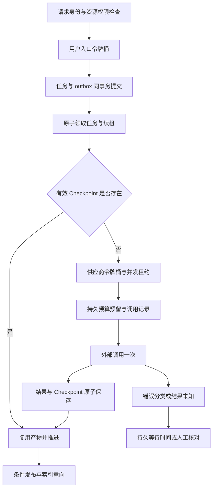

# 11 阶段级 Checkpoint 与 AI 调用控制技术方案 v1.0

编写及设计冻结日期：2026-10-30（Asia/Shanghai）。适用：当前 Python / FastAPI 课堂音频处理链。

**状态：待实施设计，未完成本轮功能或验收。** 本轮仅补文档，不修改业务代码、不执行迁移、不启动真实收费请求。配套基线见[冻结验收清单](acceptance/checkpoint-ai-control-frozen-checklist-v1.md)。

## 1. 目标、范围与现状

目标一：任务异常后复用已持久化且仍有效的阶段产物，减少重复 ASR、LLM 与 embedding 调用。目标二：限制用户提交速度和后台供应商调用速度，以持久预算、有界重试控制持续消耗。

本轮覆盖新课堂链路的音频转写、分块整理、最终汇总、笔记发布、课程索引构建与 IndexIntent 消费。保留数据库轮询 worker 和 outbox，不要求切换 Celery、接入 LangGraph checkpointer 或引入 Redisson。Python 使用项目已声明的 redis-py 异步客户端。

不包含：GB 级文件上传、断点续传、生成式学习问答、旧会议/旧聊天完整网关迁移、完整登录系统、Redis Cluster、高可用演练、全站防攻击或供应商账单级精确计费。当前固定本地主体只适合个人试用；公网多用户上线仍须先接真实认证。

| 当前源码 | 已有基础 | 本轮缺口 |
| --- | --- | --- |
| `backend/app/services/job_service.py`、`asr_provider.py` | 持久任务、provider_task_id、轮询恢复、指数等待 | 提交结果未知分类、原始结果落地、OSS 引用与清理时机持久化 |
| `backend/app/services/organize_service.py`、`models/organize.py` | 清单、成功块输出、重复恢复跳过块、条件发布 | 汇总 Checkpoint、完整配置身份、块重试目前立即循环 |
| `backend/app/services/index_service.py` | 固定构建版本指针、已写索引块复用 | 恢复重新收集来源，仅按 chunk_index 跳过；需固定来源清单与内容身份；IndexIntent 路径也须接入 |
| `backend/app/classroom_worker.py` | PostgreSQL advisory lock 限制本机单 worker | 数据库原子领取、租约续期、过期执行者提交隔离 |
| `backend/app/services/trial_budget.py` | 单机 SQLite 预算预留，失败保留额度 | 多进程共享预算、逐次调用审计与未知状态对账 |
| `backend/app/config.py`、`backend/requirements.txt` | REDIS_URL、redis==5.2.1 | Redis 令牌桶、连接生命周期、故障策略 |

本表基于源码静态复核，不替代运行测试。模块 07 中较早的 BackgroundTasks/Celery 建议不作为本轮当前状态；本方案作为专项增量约定，不改写前四阶段验收结论。

## 2. 必须成立的约束

1. PostgreSQL 保存任务、Checkpoint、产物引用、预算和调用记录；Redis 丢失不使成功产物丢失。
2. 恢复判断依据是输入身份、配置身份和有效产物，`stage` 只作展示，不能作为唯一跳过依据。
3. 已成功提交的产物与 Checkpoint 同事务提交；发布及有效版本切换不因重投产生第二份有效结果。
4. 所有实际外发尝试都经统一调用网关；拒绝限流、预算不足、等待和取消不发供应商请求。
5. 本地幂等不等于外部 exactly-once。供应商收到请求但本地未保存结果存在未知窗口，禁止笼统承诺“零重复扣费”。
6. 旧任务固定旧输入，不能读取新配置继续混跑，也不能覆盖已激活的新输入产物。



## 3. Checkpoint 数据设计

### 3.1 输入与配置身份

任务业务键：`subject_id + resource_id + job_type + input_snapshot_hash + pipeline_version + semantic_config_hash`，按规范化 JSON 的 SHA-256 计算。资源权限仍查业务表，不依赖摘要授权。

语义配置快照含供应商身份、模型名及可获得的模型修订、prompt_version、输出 schema_version、分块及 overlap、解析器版本、embedding 模型/维度等影响产物的字段。重试次数、限流参数不纳入语义摘要，单独保存 policy_version。别名模型无法保证供应商底层完全固定，记录此边界。

ASR 固定 audio_asset_id/checksum；整理固定 transcript_version_id 和有序片段清单；索引固定有序来源清单，包含来源类型、资源 ID、来源版本、稳定块 ID、正文 hash 及不可变正文或可验证引用。清单创建后禁止恢复时重新 gather_sources。新来源或配置变化须建新任务，新任务允许独立失败，不修改旧 Checkpoint。

### 3.2 新增及扩展记录

| 记录 | 字段与约束 |
| --- | --- |
| `processing_jobs` 扩展 | `subject_id`、`idempotency_key UNIQUE`、`input_snapshot_ref`、`config_snapshot JSONB`、`policy_version`、`lease_owner`、`lease_epoch`、`lease_expires_at`、`wait_reason`；保留现有 status/stage/retry_at/cancel_requested |
| `job_checkpoints` | `id`、`job_id`、`step_key`、`unit_key`（非空，阶段级固定 `stage`）、`input_hash`、`config_hash`、`status`、`output_ref`、`output_hash`、`schema_version`、`finished_at`；唯一 `(job_id, step_key, unit_key)` |
| `provider_calls` | `id`（attempt_id）、`operation_key`、`attempt_no`、`job_id`、`checkpoint_id`、`provider`、`model`、`request_hash`、`provider_request_id/task_id`、`status`、`error_code`、`retry_at`、`started_at/finished_at`、`usage`、`reserved_amount`、`settled_amount`、`usage_state`；唯一 `(operation_key, attempt_no)` |
| 预算账户与预留 | 主体日账户、全局日账户及试用总账户；金额用定点整数微元或 NUMERIC，不用 float；以 attempt_id 唯一预留/结算，行锁串行化多账户检查 |

Checkpoint 状态：pending/running/succeeded/failed/unknown。provider_calls 状态：reserved/in_flight/succeeded/failed/unknown/not_sent。结果有效需要状态成功、引用可读取、输出 hash 及 schema 匹配；`succeeded` 但引用损坏不能直接算成功，应返回 `checkpoint_corrupt`，停止并人工决定重建。

大结果写不可变文件/对象后再在数据库提交引用；写成功但数据库回滚形成孤立对象，按引用扫描清理，不能删除已引用对象。小结构化结果可沿用现有 JSONB，避免把整段课堂正文写进通用日志。

### 3.3 阶段与提交边界

| 链路 | Checkpoint / 单元 | 持久产物和恢复动作 |
| --- | --- | --- |
| ASR | `asr.submit` | 预先记录提交意图；回执 task_id 与 OSS object_key 保存后继续轮询，不再次 submit |
| ASR | `asr.result` | 保存原始成功结果或完整可解析片段及 hash；解析/发布失败后复用，避免再次向供应商取结果 |
| ASR | `transcript.publish` | 转写版本、片段、Checkpoint、job.output_version 同事务提交，重复执行引用同一版本 |
| 整理 | `organize.manifest` | 冻结分块清单、原文身份与配置；复用现有 ChunkManifest/ChunkItem |
| 整理 | `organize.extract / chunk_id` | ChunkItem 成功输出与 Checkpoint 同事务写入，只执行未完成块 |
| 整理 | `organize.summary` | 保存最终汇总输入 hash、模型结构化输出；发布前崩溃不重新 summarize |
| 整理 | `note.publish` | 校验覆盖率/证据、写笔记和条件切换、IndexIntent、Checkpoint 同事务；旧输入可完成归档产物但不能切 active |
| 索引 | `index.manifest` | 固定来源快照、配置、IndexVersion；显式建索引与 IndexIntent 归并到相同构建机制 |
| 索引 | `index.embed / stable_unit_key` | 向量、来源元数据、Checkpoint 同事务落地；单元身份由来源版本、块身份、内容 hash 组成，不能只用序号 |
| 索引 | `index.activate` | 覆盖/维度/来源可用性校验后条件切换；过期构建不得顶替更新的 active |

现有块表和索引表仍是产物事实表，Checkpoint 引用它们，不维护第二套互相冲突的输出状态。整合写入边界；不能保留内部提前 commit 再补 Checkpoint 的双写窗口。

ASR 的 OSS object_key、清理状态需持久保存，不能仅保存在进程字典中；轮询超时不立即删源对象。成功落地 asr.result 或供应商确认终态/取消且无需源对象后异步清理；清理失败重试，不重提 ASR。终态失败的 task_id 不无限重复轮询，明确失败或显式创建新操作。

## 4. 领取、恢复与外部未知窗口

任务原子领取在短事务中使用 `FOR UPDATE SKIP LOCKED` 或等价条件更新，写 owner、epoch、lease_expires_at 后释放锁，外部请求期间不持有数据库行锁。所有执行入口（含 run_job 与 IndexIntent）统一走领取逻辑，不依赖 CLI 的单机锁保证并发安全。

冻结租约 60 秒、心跳间隔 10 秒；独立协程和独立数据库 session 在长调用期间续租。每次产物提交、预算结算关联以及 active 切换检查当前 owner/epoch。旧执行者租约失效后禁止新调用和产物发布；迟到响应可登记调用审计并由恢复者接管，不得无记录丢弃。后台需要非阻塞 HTTP/存储访问，避免阻塞事件循环导致心跳失效。

恢复顺序：查取消/授权归档 → 领取租约 → 校验输入配置快照 → 查成功 Checkpoint 与产物 → 查在途调用记录 → 执行首个未完成阶段。按依赖恢复，不能凭 stage 序号跳过验证。

外部未知处理：

- 已有 task_id：只恢复轮询。供应商明确任务不存在/失败时，不把它误判成临时网络错误。
- 供应商支持可验证幂等键或查询时：优先查询或复用原 operation_key，不能每次生成新业务幂等键。
- 提交成功后本地落库前崩溃，或超时无法判断是否执行：记录/恢复为 unknown，`wait_reason=provider_unknown`，禁止自动重新发起可能收费的非幂等请求。
- LLM/embedding 响应收到但结果未提交也属于未知窗口。没有供应商查询能力时需要人工核对后显式重跑，记录操作人/原因和新增预留；不伪造“已确认未收费”。
- 本轮未知核对可通过受控运维入口完成，不强制建设人工审核页面；未核对任务不得被通用 retry 接口自动清空未知状态。

取消在等待、调用前和提交前检查。已在途响应仍记账；取消后不发布新 active，不再发下一次请求。复用已完成的阶段结果不会产生新的 provider_calls。

## 5. Redis 令牌桶

### 5.1 两类入口与身份

用户入口：覆盖新课堂音频上传、新建整理、文档上传/重建引起的索引任务、显式索引构建、手动重试；按服务端 ScopeContext.subject_id 和 operation_family 分桶。读任务、读证据、取消任务不消耗此桶。权限检查保持现有 404 隔离语义；超限不得创建 asset/job/outbox 或收费请求。入口拒绝可能已接收 HTTP multipart 临时数据，本轮不承诺网络层上传防护。

供应商入口：覆盖 worker 自动转写提交/查询、整理块、汇总、索引 embedding 及 IndexIntent 所有实际外发请求。按 credential_alias（不含密钥）、provider、operation_family 分桶，模型映射到供应商实际共享配额组；按模型单独分桶不能绕过共享总额。重试与首次调用相同扣令牌。

固定本地主体不是认证。客户端不能自选 subject_id；未接认证前仅声明“个人版主体限流与多进程一致性”。IP 可未来补辅助限流，不能把可伪造转发头当唯一身份。

### 5.2 算法与冻结配置

`rl:v1:<environment>:<policy_version>:<scope_hash>:<operation_family>` 为 key，Hash 存 tokens、last_ms；不写 API key/正文。Redis 单实例为本轮拓扑。

一次 Lua 完成 Redis TIME 取时、读状态、补充令牌、检查/扣减、写回和 PEXPIRE。应用不使用“先 GET 再 DECR”。计算：

```text
elapsed = max(0, now_ms - last_ms)
available = min(capacity, tokens + elapsed * refill_per_second / 1000)
allowed = available >= cost
remaining = allowed ? available - cost : available
retry_after_ms = allowed ? 0 : ceil((cost - available) / refill_per_second * 1000)
last_ms = max(now_ms, last_ms)
ttl_ms = max(60000, ceil(capacity / refill_per_second * 2000))
```

校验 capacity>0、refill>0、0<cost<=capacity，非法配置启动失败。拒绝也写回补充后的状态，不透支；时钟回退不倒退 last_ms。桶自然满的时间短于 TTL，正常空闲过期后重建满桶不额外超发。EVALSHA 缓存丢失时只对 NOSCRIPT 重新加载脚本；超时不盲目重放扣减，不对结果未知的扣减退款。

| 策略 | capacity | refill/s | cost | 说明 |
| --- | ---: | ---: | ---: | --- |
| 用户每 operation_family | 3 | 0.1 | 1 | 允许短突发；不是每分钟只能 6 次的固定窗口 |
| 供应商生成/整理共享组 | 2 | 0.5 | 1 | 每实际请求扣一次 |
| embedding 共享组 | 2 | 1 | 1 | 本轮每批最多 8 块、每块不超现有 1000 字符；不允许无限批量绕限额 |
| ASR 提交组 | 1 | 0.1 | 1 | 沿用 120 秒、8MB 真实试用限制 |
| ASR 查询组 | 2 | 1 | 1 | 每次底层查询均受控，正常轮询至少间隔 5 秒 |

这些数值为本项目实施/验收基线，不代表供应商公布的限额；部署时取项目值与实际配额中更保守者，并在证据包记录。Redis 容量拒绝不 refund；后续预算拒绝允许浪费一次吞吐令牌，不影响资金正确性。

额外冻结供应商在途并发上限 2，采用数据库可续租 permit，和任务租约绑定、过期可回收，取消/响应后释放；令牌桶控制速率，permit 控制长请求并发。未知外部请求可能仍在供应商执行，标为未知并阻止该业务操作自动重发，不宣称远端绝对并发上限。

### 5.3 响应与故障策略

用户桶拒绝：HTTP 429，`code=rate_limited`、`retryable=true`、`retry_after_seconds`、request_id，Retry-After 向上取整且至少 1 秒。资源越权保持原有 404；预算不足返回 409 `budget_exhausted`，`retryable=false`（需额度变化或人工处理）。

worker 桶拒绝：不对前台已经返回的任务再返回 429；落库 `retry_wait`、`wait_reason=rate_limited`、retry_at，释放执行租约，恢复时重新领取。限流/并发/Redis 不可用等待均不增加外部 attempt_no、不预留预算；累计控制等待超过 900 秒进入 failed `control_wait_exhausted`，防止永久排队。

Redis 连接超时 1 秒、连接池上限 20，FastAPI lifespan 和 worker 各管理一个异步池，退出 await aclose。Redis 不可用时用户付费任务入口返回 503 `rate_limit_unavailable`，worker 等待至少 5 秒再检查，禁止本地无限放行；读结果/取消/纯本地发布继续可用。Redis 故障不删除 Checkpoint 或改写已完成任务。

Redis 重启或 key 被驱逐可能重建满桶：速率保障只在桶状态保留期间成立。配置独立命名空间与适合的持久化/内存策略，部署记录实际设置；持久预算仍限制累计金额。不得把 Redis 令牌桶当收费总额的唯一防线。

## 6. 统一调用网关与持久预算

建议新增 `ai_call_gateway.py`、`rate_limit_service.py`、`checkpoint_service.py`、`call_budget_service.py`，Lua 放 `backend/app/scripts/token_bucket.lua`；新增模型及 Alembic 迁移。复用现有 retry 分类但消除多层重复重试。

调用顺序：检查租约/取消/Checkpoint → 令牌桶 → 领取并发 permit → 短事务锁定主体/全局/试用预算并预留、建立 provider_calls → 标记 in_flight 后外发一次 → 结果/调用状态/Checkpoint 提交 → 按 attempt_id 幂等结算 → 释放 permit。等待期间释放 permit 和数据库锁；调用前预算事务失败则不外发。

预算使用数据库账户，固定锁顺序 global→subject→trial，预算预留和调用记录同事务。冻结主体日上限 5 元、全局日上限 10 元，原单次试用累计 10 元上限继续保留，取所有适用账户的最小可用额度；业务日按 Asia/Shanghai，存储 UTC。跨午夜结算归原预留账户，不因跨日释放未知费用。

每次请求使用明确的输入/输出上限、ASR 时长或 embedding 批量上限，结合版本化费率估算保守预留；沿用试用每次至少 1 元的保守预留下限。费率/usage 不可确定时保留整份预留，记录 usage_state=unknown/estimated，不能记零或自称供应商账单精确值。请求确认未发送可释放预留；可能已发送或失败可能收费则保留/按已知用量结算。

结算和重复回执不重复扣款，不能退还其他 attempt 的额度；真实费用高于预留时记录差额和阻断后续调用，不能隐去超额。现有 SQLite 账本先迁移/保守汇总到试用账户，冻结时停旧 worker，禁止新旧双写；不删除旧记录，也不通过新日账户重置原试用累计额度。主体日额度不替代持续低频滥用的账号治理，本轮不宣称全面防恶意攻击。

网关下层只负责一次 HTTP 请求和结果解析。关闭 SDK 内部自动重试；拆开 `_poll_task` 中底层查询循环使每次查询过网关；embedding 批次和 IndexIntent 路径同样覆盖。若保留 SDK 重试，则每个实际网络尝试必须独立入网关和记账；本轮采用关闭方案。

## 7. 重试、等待及耗尽

| 结果 | 行为 |
| --- | --- |
| 明确 429、部分临时 5xx；供应商确认未执行或支持幂等重放 | 进入持久退避，下一尝试重新过限流/预算 |
| ASR 正常未完成 | 定时继续查询，保留 task_id；不当成提交失败，不重新提交 |
| 查询超时、连接异常 | 幂等查询可有界重试；非幂等提交无法证明未执行则 unknown |
| 401/403、非法参数、配置错误、无语音、非法 schema/维度 | 失败并保留已发生消耗，本轮不做自动提示词修复循环 |
| 预算不足 | 停止新调用，保留 Checkpoint，不能在循环里等待释放额度 |
| 本地限流、并发满、Redis 不可用 | 控制等待，不增加外部请求次数；按第 5 节计等待上限 |
| provider_unknown | 暂停核对，不能按普通可重试失败重发 |

定义 attempt_no 为该 operation 的实际请求次数，含首次最多 3 次；job.attempt 仅作调度次数展示。自动恢复和手动重试不重置已消耗的外部次数，显式重跑须生成新操作并再次过入口限流和累计预算，保留旧操作审计。

冻结 base=2 秒、cap=30 秒、max_attempts=3、单次 HTTP timeout=30 秒（ASR 查询也是单次 30 秒，正常任务轮询总截止 900 秒）。第 n 次失败后：`backoff=Uniform(0, min(30, 2*2^(n-1)))`；`delay=max(backoff, parsed_retry_after, local_limiter_delay)`。Retry-After 支持秒数和 HTTP-date；坏值忽略并记诊断。供应商等待提示超过剩余 900 秒操作期限时停止自动重试，不能截短后提前请求。

外部操作重试总期限 900 秒，从首次实际发出计；ASR 另计首次提交后的 900 秒轮询期限。每个逻辑单元独立计数；正常 ASR poll 的每次查询也限流/记录，但正常 pending 不消耗提交重试次数。失败查询按连续错误最多 3 次，成功 pending 重置连续错误计数，总轮询期限不重置。

等待落库 retry_at，释放 worker 去处理其他任务，重启不清零 deadline/attempt_no。不能在 organize.extract 的 while 中立即重发，也不能在 SDK、网关、job 三层各试 3 次变成 27 次。长 Retry-After、取消和过期租约必须在再次出网前检查。

## 8. 接口与可观测性

沿用 `/api/jobs/{id}`、retry、cancel，增加只读字段 `wait_reason`、`retry_at`、`last_successful_stage`、`completed_units/total_units`、`resume_count`，unknown 明确显示“调用结果待核对”。内部 task_id、output_version 保持现有权限隔离；不通过接口暴露 OSS 签名 URL、内部文件路径或跨主体预算。

日志/审计关联 request_id、job_id、checkpoint_id、attempt_id、lease_epoch、策略版本、等待原因、错误分类、token 用量与金额计量状态。指标包含 Checkpoint 命中/缺损、实际请求次数、按原因等待/拒绝、未知调用数、预留/结算/未知额度；不默认记录原文、完整 prompt、密钥或签名 URL。

成本收益用固定替身调用计数验证，不用替身推算真实 Token 节省率。报告实际调用数、复用单元数以及计量状态，不在未测量时宣称节省百分比。

## 9. 实施顺序、迁移和回退

1. 数据与配置：新增迁移、任务身份/来源清单/调用记录/预算表、冻结默认值；清理冲突前先报告重复项，不直接删除数据。
2. Checkpoint：整理汇总 → ASR 结果与 OSS 生命周期 → 索引来源快照及 IndexIntent → 原子发布与租约。
3. 调用控制：Redis 异步池/Lua → 单次请求网关 → 三类 provider 接入 → 预算 → 持久退避与取消。
4. 界面/状态：兼容增加状态字段，不把等待显示为处理成功；完善配置样例与启动说明。
5. 验证：隔离真实 PostgreSQL/Redis、确定性 provider、固定故障点；最后人工决定真实短录音联调。

旧 succeeded 任务和 active 版本原样读取；可证明输出身份完整的旧成功块可登记 Checkpoint，否则不伪造。旧 running/retry_wait 先停止旧 worker，保留 task_id/产物，迁移为待核对或按可证明状态恢复。来源快照不完整的旧索引构建不得继续按新数据续写，可保留旧 active 并创建明确的新构建任务。

旧配置缺少 prompt/schema/policy 版本时使用显式 legacy 身份，不与新配置任务碰撞。迁移在干净库与已有前四阶段数据的副本分别验证，预算迁移需对账。回退先停止新 worker 和新任务入口，保留新增表、调用记录及账本，不自动降级为旧的无控制付费路径；只读原有 active 结果可继续。禁止对已有真实调用记录做破坏性降级迁移。

## 10. 冻结参数与资料

实施需在配置样例中映射上述容量/补充速率、租约、并发、超时、最大尝试、等待期限、日额度与试用累计上限。参数可在未来新版本调整，本轮验收不得临时换值；真实部署额外采用供应商更严格限额须单独记录。

本轮自动证据无需收费模型；依赖版本按项目 requirements 锁定验证，不因在线文档版本更高而直接升级。

- Redis Lua 原子执行边界：[Redis programmability](https://redis.io/docs/latest/develop/interact/programmability/)。原子性用于本轮单实例桶更新，不代表 Redis 与 PostgreSQL 跨库事务。
- Python 异步池生命周期参考：[redis-py asyncio](https://redis.io/docs/latest/develop/clients/redis-py/async/)。本项目仍需按已声明的 5.2.1 验证。
- 任务短事务领取参考：[PostgreSQL 16 SELECT / SKIP LOCKED](https://www.postgresql.org/docs/16/sql-select.html)。本轮不把 SKIP LOCKED 用于要求完整一致性的来源快照读取。
- 非幂等请求自动重试及 Retry-After 语义：[RFC 9110 §9.2.2](https://www.rfc-editor.org/rfc/rfc9110.html#section-9.2.2)、[§10.2.3](https://www.rfc-editor.org/rfc/rfc9110.html#section-10.2.3)。未知结果处理采用比盲重试更保守的项目策略。
