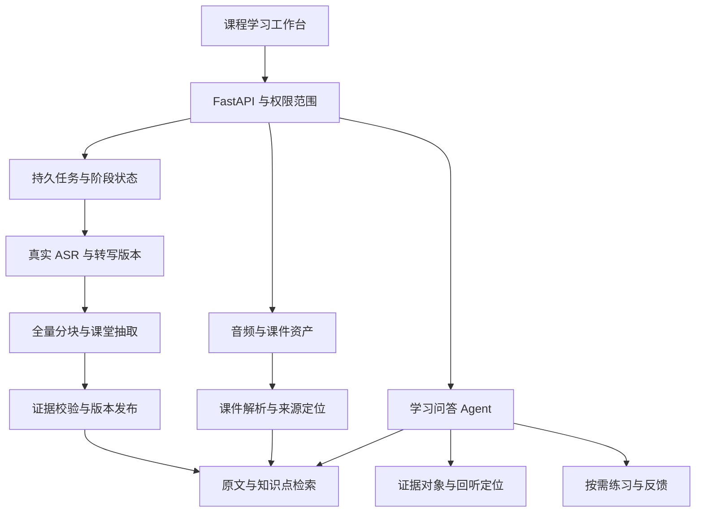

> 当前入口为 [需求](reset-v1/01-requirements.md)、[修改方案](reset-v1/02-plan.md)、[v1.2 冻结清单](reset-v1/03-acceptance-v1.2.md)和[最终验收报告](reset-v1/17-final-review-v1.2.md)。
>
> 以下为 2026-10-27 历史设计。练习、批改等扩展设想以当前需求范围为准。
# 课堂录音与学习问答 Agent：分模块改造方案

编写日期：2026-10-27。适用对象：当前 yuan-meeting-main 源码。

本文档是待实施设计，不表示相应功能已经完成。本次仅编写方案，没有修改业务代码、数据库或调用外部模型。现状依据根目录 PROJECT_CLASSROOM_AUDIT.md 及本次对关键源码的复核；未经实测的性能、准确率和容量不作承诺。

## 1. 产品目标与范围

把现有会议整理与决策检索平台，改造为面向学生的课堂录音整理与学习问答助手。核心交付为：创建课程 → 上传或录制课堂音频 → 真实转写 → 带证据的课堂笔记与知识点 → 课程范围内问答 → 点击引用回听。

第一版先完成上传录音闭环，再增加浏览器录音。首版支持可提取文本的 PDF、DOCX、TXT、Markdown；PPTX、扫描件 OCR、实时字幕与自动复习调度分阶段增加，不作为首版交付前提。

课堂记录只能证明“课堂讲过什么”，不能证明“学生掌握了什么”。掌握情况必须来自作答、反馈或明确的学习行为记录。

## 2. 模块文档

| 模块 | 文档 | 主要交付 |
| --- | --- | --- |
| 01 课程、课时与数据模型 | [模块方案](01-domain-and-data.md) | 业务边界、表结构、数据迁移与用户范围 |
| 02 录音、上传与音频资产 | [模块方案](02-recording-and-assets.md) | 上传、浏览器录音、文件校验与媒体访问 |
| 03 ASR、转写与纠错 | [模块方案](03-transcription.md) | 真实转写、版本、纠错、失败与重跑 |
| 04 课堂整理与结构化抽取 | [模块方案](04-classroom-processing.md) | 长文本分块、笔记、知识点、例题和作业 |
| 05 课件、索引与检索 | [模块方案](05-knowledge-and-retrieval.md) | 原文索引、课件定位、范围过滤与检索评估 |
| 06 学习问答 Agent | [模块方案](06-learning-agent.md) | 有限工具循环、证据回答、SSE 与引用 |
| 07 任务、Harness 与可观测性 | [模块方案](07-jobs-and-harness.md) | 持久任务、幂等、恢复、预算与监控 |
| 08 前端学习工作台 | [模块方案](08-frontend.md) | 页面改造、播放器联动、课程问答体验 |
| 09 练习、反馈与复习 | [模块方案](09-practice-and-review.md) | 出题、作答、判分、错题与后续调度 |
| 10 迁移、验证与交付 | [模块方案](10-migration-and-validation.md) | 发布顺序、测试矩阵、数据兼容与回退 |
| 11 Checkpoint 与 AI 调用控制专项 | [技术方案](11-checkpoint-and-ai-call-control.md) · [冻结验收清单](acceptance/checkpoint-ai-control-frozen-checklist-v1.md) | 阶段产物恢复、Redis 令牌桶、持久预算与有界退避；2026-10-30 增补，待实施/待验收，不改变既有阶段编号 |

## 3. 总体架构

保留 React、FastAPI、SQLAlchemy、PostgreSQL/pgvector、LangGraph、SSE 与虚拟列表。复用基础设施不代表直接复用会议业务字段；新建课堂业务模型，旧模型通过兼容层逐步迁移。

## 4. 跨模块约定

1. **身份与范围**：服务端确定当前用户；`course_id`、`lecture_id` 只表示请求范围，不能替代权限检查。SQL/向量/全文/工具/证据读取均使用同一范围对象。
2. **版本与可追溯性**：音频、转写、笔记、索引各自有版本；任务固定输入版本。回答保存其实际使用的证据版本，不能自动指向后续更正的文本。
3. **时间单位**：媒体定位统一使用从录音开头计算的整数毫秒；数据库时间使用带时区时间并统一存储，前端按用户时区显示。旧秒值迁移时显式转换。
4. **发布与失败**：新产物先进入草稿或构建状态，成功后原子切换有效版本；失败不覆盖旧的已发布结果。存在缺失分块的任务不得显示“全课处理完成”。
5. **演示隔离**：业务环境禁止真实 ASR 失败后自动生成 Mock。演示资产标记 `is_demo`，不进入正式课程检索与学习记录。
6. **证据优先**：教师原话、材料推导、模型补充解释分别标记；模型自报置信度不等于事实正确率。
7. **错误响应**：统一使用 `code`、`message`、`retryable`、`request_id`；不向用户返回密钥、内部路径和供应商原始敏感信息。
8. **接口说明**：各模块中的端点均为目标接口，默认带 `/api` 前缀；实施时通过 schema 与接口文档固化。旧接口兼容窗口见模块 10。

## 5. 交付阶段与依赖

| 阶段 | 依赖与工作范围 | 阶段出口 |
| --- | --- | --- |
| M0 基础可信度 | 模块 01/02/03/07/10 的基础部分 | 上传安全、真实失败可见、干净库迁移可用、任务重跑不重复 |
| M1 课堂整理 MVP | M0 → 模块 04/05/08 | 上传真实录音，完整处理全课，笔记引用可回听 |
| M2 学习问答 Agent | M1 → 模块 06、完善 05/07/08 | 课程范围问答、工具调用、有效引用和证据不足处理 |
| M3 录音与练习 | M2 → 模块 02 浏览器录音、模块 09 | 直接录音可恢复，练习可作答并得到可核对反馈 |

模块可以分批交付，但课程归属、来源版本、证据结构和任务幂等必须先确定，避免抽取、检索和前端分别形成不兼容设计。

## 6. 首版明确不做

- 不继续扩展实时多人会议、SFU 和旧实时 ASR 支线。
- 不把风险表当学生薄弱点表，不把决策表改名后当知识点表。
- 不仅索引 AI 摘要；课堂原文和课件是主要证据来源。
- 不为“多 Agent”拆分没有独立输入、输出或验收价值的节点。
- 不在没有标注集、运行记录和测量条件时宣传准确率、性能或学习效果提升。

## 7. 建议开始实施的顺序

先提交数据迁移与范围对象，再补音频资产和持久任务；随后完成真实转写版本与证据对象；最后接课堂抽取、索引、引用回听和学习问答。每次提交围绕一个可验证行为，具体检查见模块 10。

